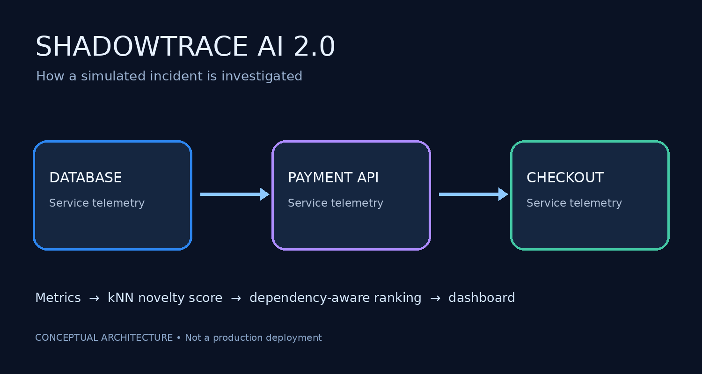

# ShadowTrace AI 2.0

**Java-based anomaly detection and root-cause investigation demo for interconnected services.**



> **Scope:** Educational prototype. Uses **synthetic telemetry** and a kNN novelty detector trained on generated healthy examples. Root-cause results are **ranked hypotheses**, not verified causation. This is not a production monitoring system.

## Problem statement

A slowdown in one backend service can trigger failures in dependent services. Investigating each service independently can make it hard to prioritize where engineers should start. ShadowTrace AI demonstrates how anomaly detection plus a service dependency graph can support incident triage.

## Features

- Java 17+ backend using only the Java standard library.
- Per-service **k-nearest-neighbor novelty detection** (`k=7`) using 500 synthetic healthy training vectors and 250 validation vectors per service.
- Live dashboard refreshed every 2 seconds, with anomaly trends, severity, and recent alerts.
- Simulate an incident, restore healthy metrics, or pause synthetic telemetry.
- Heuristic root-cause ranking using anomalous direct dependents.
- REST endpoints to read system status and submit custom measurements.
- CSV incident and telemetry logging; automated Java tests.

## Architecture


**Services in demo:** Database → PaymentAPI → Checkout, with Database also directly affecting Checkout.

## Run locally (Windows)

1. Install **JDK 17+** and verify `java -version` and `javac -version`.
2. Open the repository folder in VS Code.
3. Run `run.bat` (or `./run.bat` in PowerShell).
4. Visit **http://localhost:8080**.
5. Select **Simulate incident** to observe anomaly detection and a suspected upstream database issue.
6. Press **Ctrl+C** in the running terminal to stop.

macOS/Linux: `bash run.sh`.

## Screenshots

Capture and add screenshots from your own running application:

1. Run `run.bat` and open `http://localhost:8080`.
2. Capture the healthy dashboard and save it to `docs/images/dashboard-healthy.png`.
3. Click **Simulate incident** and save `docs/images/dashboard-incident.png`.
4. Commit these images and optionally embed them here.

## API

| Method | Endpoint | Purpose |
| --- | --- | --- |
| GET | `/api/status` | Current metrics, alerts, history and root hypothesis |
| POST | `/api/demo/incident` | Enable synthetic incident mode |
| POST | `/api/demo/healthy` | Restore synthetic healthy mode |
| POST | `/api/demo/pause` | Pause/resume synthetic generation |
| POST | `/api/metrics` | Submit a reading for a known service |

Example in PowerShell (pause the generator first to prevent overwrites):

```powershell
Invoke-RestMethod -Method Post -Uri http://localhost:8080/api/metrics -ContentType 'application/json' -Body '{"service":"Database","latency":320,"errors":4.5,"cpu":82,"integrity":99.4}'
```

## Run tests

Windows: `test.bat` · macOS/Linux: `bash test.sh`.

## How the model works

Each service has a baseline mean and scale for latency, error rate, CPU usage and data integrity. The model standardizes incoming values, computes average distance to the 7 nearest synthetic healthy training points, and divides that distance by a threshold derived from healthy validation samples. Ratios `>= 1` are warnings and `>= 2` are critical. A dependency-aware heuristic then ranks suspected root causes. **The root-cause rank is not a causal probability.**

## Limitations and future work

- Synthetic training and simulation; no benchmarked real-world precision or recall.
- No authentication or production-grade input validation; intended for local development.
- Heuristic ranking does not establish causation or use distributed traces.
- Future work: ingest real telemetry, add labelled incident evaluations, compare models, introduce authenticated APIs, and implement durable storage.

## Author

**Yash Srivastava** · B.Tech CSE (Data Science), Chandigarh University.

## Usage rights

No open-source license is granted in this repository. The code is publicly viewable, but reuse rights are not automatically granted beyond applicable platform terms and law. Please contact the author regarding reuse.
